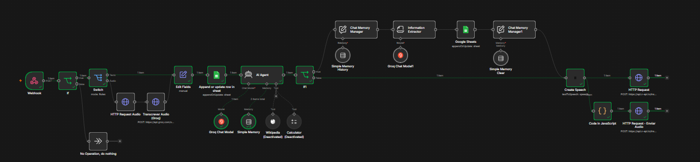

# 🤖 Bot de Triagem - Instituição Vindaça

## 📌 Sobre o Projeto
Automação de triagem via WhatsApp desenvolvida para a **Instituição Vindaça** (Fortaleza - CE). O sistema automatiza a coleta e estruturação de dados de novos cadastros, permitindo interação por texto e por mensagens de áudio para atender usuários com limitações de leitura e escrita.

## ⚙️ Tecnologias
O fluxo foi construído no **n8n** e utiliza os seguintes componentes:

* **Groq Cloud (Whisper-large-v3):** Transcrição de áudio (STT) configurada com contexto para sotaque regional e nomes de bairros de Fortaleza.
* **ElevenLabs (Multilingual V2):** Geração de voz (TTS) utilizada na validação inicial do protótipo.
* **LLM (Agente IA):** Condução da entrevista e estruturação das respostas.
* **Google Sheets:** Armazenamento temporário dos cadastros durante a etapa de testes.

## 🧠 Estrutura do Fluxo
1. **Roteamento de Mídia:** Um nó `Switch` separa mensagens de texto e áudio. Áudios são enviados via `HTTP Request` (`multipart/form-data`) para a API de transcrição da Groq.
2. **Gerenciamento de Estado:** Nós de memória (`Simple Memory` e `Clear Message History`) gerenciam o contexto da sessão e redefinem o histórico ao concluir o cadastro.
3. **Extração Estruturada:** O nó `Information Extractor` filtra a conversa e consolida quatro campos obrigatórios: **Nome**, **Idade**, **Bairro** e **Necessidade**.

## 🚀 Próximos Passos (Migração VPS)
- [ ] **Blindagem do Fluxo:** Implementar tratamento de exceções, trava de tamanho de áudio e restrições de prompt injection/LGPD.
- [ ] **Self-Hosted:** Deploy do n8n em ambiente Docker (VPS).
- [ ] **Evolution API:** Integração com a API local de WhatsApp.
- [ ] **Edge-TTS:** Substituição do ElevenLabs por serviço de voz local gratuito.
- [ ] **Banco Relacional:** Substituição do Google Sheets por banco relacional local (operação *Upsert* via telefone).

## 👨‍💻 Desenvolvedor
**Kaíque Fraga**  
[LinkedIn](https://www.linkedin.com/in/kaique-nunes-vasconcelos-fraga-580867286/) | [GitHub](https://github.com/0110101101100001)
